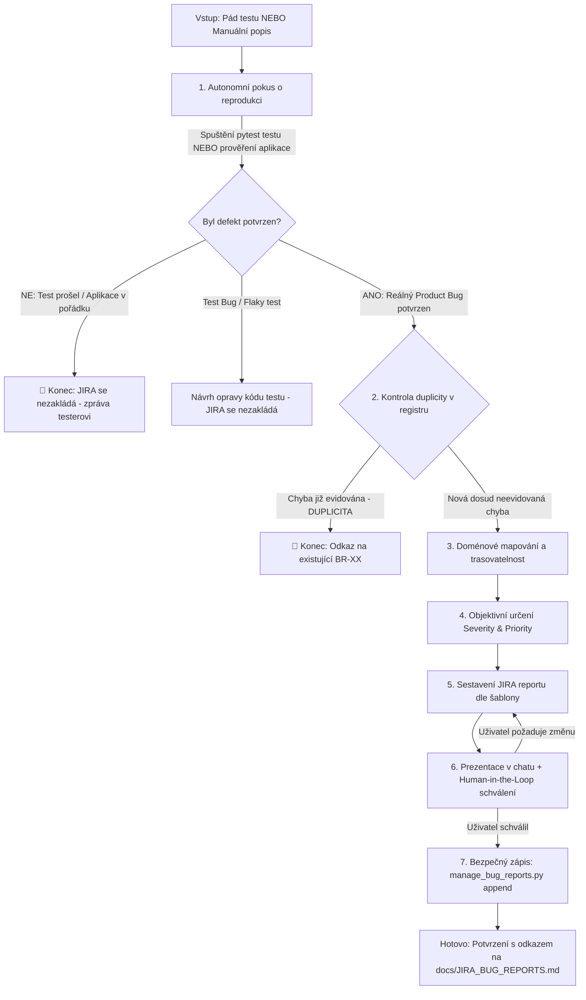

# 🐞 Bug Reporting – Standardy hlášení chyb a správa incidentů (JIRA)

Metodika pro profesionální tvorbu a evidenci hlášení chyb (Defect Reports) v projektu vzdělávacího portálu Kitner.cz podle standardů **ISTQB** a projektového registru [docs/JIRA_BUG_REPORTS.md](../../../docs/JIRA_BUG_REPORTS.md).

> **Základní princip:**  
> *Každé hlášení musí být reprodukované, ne-duplicitní, opřené o technické důkazy a přímo trasovatelné na User Story a Test Case.*

---

## 🧭 Základní workflow agenta (Krok za krokem)



---

## 1. 📥 Verifikace, Triáž a Kontrola duplicity (MANDATORNÍ)

Zlaté pravidlo QA: **Nehlásit neověřené chyby, nehlásit chyby testovacího kódu a nezakládat duplicity.**

### 🔍 Krok 1: Autonomní pokus o reprodukci
Agent **vždy nejprve aktivně ověří**, zda se chyba skutečně projevuje:
* **U automatizace:** Spustí dotčený test v terminálu:  
  `./.venv/bin/pytest tests/<slozka>/<soubor>.py -k "<nazev_testu>" -v`  
  - *Pokud test projde (PASS):* **JIRA ticket se ZÁSADNĚ NEZAKLÁDÁ!** Agent informuje uživatele s výstupem testu.
  - *Pokud test selže (FAIL):* Získá čerstvý důkaz (log, timeout, screenshot) a pokračuje.
* **U manuálního hlášení:** Ověří chování spuštěním testu nebo prověřením stránky.  
  - *Pokud aplikace funguje správně:* **JIRA ticket se NEZAKLÁDÁ.** Agent vysvětlí korektní stav doložený akceptačním kritériem.

### 🛑 Krok 2: Triáž incidentu
* 🛑 **Test Bug / Flaky Test:** Selhání kvůli lokátoru, setupu nebo flaky síti (aplikace je v pořádku) ➔ **JIRA se nezakládá**, agent navrhne opravu testu.
* 🐞 **Product Bug:** Aplikace reálně padá, chybuje, nevaliduje nebo porušuje User Story ➔ pokračovat.

### 🔎 Krok 3: Kontrola duplicity v registru
Agent ověří stávající incidenty:  
`python3 .agents/skills/bug_reporting/scripts/manage_bug_reports.py list`
* **Pokud již chyba existuje (DUPLICITA):** **Nový ticket se NEVYTVÁŘÍ.** Agent odkáže na existující `BR-XX` a jeho stav (`🔴 Otevřeno` / `🟡 V řešení`).
* **Pokud jde o novou chybu:** Pokračuje k sestavení hlášení.

---

## 2. 🗺️ Doménové mapování a trasovatelnost

Vazby agent vyhledá v [domain_mapping.md](./references/domain_mapping.md):
1. **Modul & Komponenta:** `AUTH`, `CRS`, `ENR`, `LEC`, `PRF` nebo `SEC`.
2. **Vázané User Stories:** Odkaz do [docs/požadavky_ust_podle_src.md](../../../docs/požadavky_ust_podle_src.md) (např. `US-18`, lze i více).
3. **Související Test Case:** Kód z [docs/TEST_CASES.md](../../../docs/TEST_CASES.md) a cesta k testu (pokud test neexistuje: `Zatím nepokryto`).
4. **Inspekce kódu testu:** Z fází *Arrange* a *Act* v `tests/` zrekonstruuje číslované **Kroky k reprodukci**.

---

## 3. ⚖️ Určení Závažnosti (Severity) a Priority (Priority)

Hodnoty se určují výhradně podle matice v [severity_vs_priority.md](./references/severity_vs_priority.md):
* **Severity (Technický dopad):**
  - `Critical / Blocker`: Bezpečnostní zranitelnost (OWASP), pád či zamrznutí aplikace, poškození či ztráta dat, blokace testování.
  - `High`: Závažné selhání byznysové cesty bez workaroundu, blokace akce na podporovaných zařízeních/rozlišeních.
  - `Medium`: Běžná funkční či validační chyba s workaroundem, pomalá odezva či výkonnostní propad.
  - `Low`: Kosmetická, typografická nebo drobná UX/layoutová vada.
* **Priority (Byznysová naléhavost):**
  - `High`: Blokuje release, testování, kritický nákupní proces nebo bezpečnost.
  - `Medium`: Plánovaná oprava v následujícím sprintu.
  - `Low`: Odložitelné do backlogu, drobná estetická úprava.

---

## 4. 📋 Standardní formát JIRA ticketu

Ticket se striktně řídí šablonou v [jira_template.md](./references/jira_template.md). Každé hlášení musí obsahovat:
* **JIRA Metadata:** ID (`BR-XX`), Summary s modulem `[MODUL/Komponenta]`, Komponenta, Severity, Priority, **Reprodukovatelnost** (`Vždy (100 %)` / `Nahodile` / `Pouze jednou`), vázané US, TC, Prostředí, Nahlásil (`Andrea Wanková`), Datum.
* **Obsah:** Popis, Předpoklady, Kroky k reprodukci, Očekávané vs. Skutečné chování, Bezpečnostní/Byznysový dopad (OWASP), **Technický důkaz a vizuální záznamy** (screenshot z `reports/screenshots/`, trace z `reports/traces/`, failure log), Doporučené řešení (Frontend/Backend) a Verifikaci.

---

## 5. 🤝 Human-in-the-Loop schválení a bezpečný zápis

**Agent NESMÍ zapsat nový bug report do `docs/JIRA_BUG_REPORTS.md` bez výslovného souhlasu uživatele!**

1. **Zjištění nového ID:**
   ```bash
   python3 .agents/skills/bug_reporting/scripts/manage_bug_reports.py next-id
   ```
2. **Prezentace uživateli:** Agent zformátuje hlášení, zobrazí jej v chatu pro Ctrl+C / Ctrl+V do JIRA a požádá o schválení:  
   *„Chcete, abych tento report pod ID `BR-XX` uložil do centrálního registru docs/JIRA_BUG_REPORTS.md?“*
3. **Zápis po potvrzení:** Až po schválení uživatelem agent report bezpečně zapíše:
   ```bash
   python3 .agents/skills/bug_reporting/scripts/manage_bug_reports.py append <cesta_k_souboru>
   ```

---

## 📚 Referenční dokumentace a nástroje

* **[manage_bug_reports.py](./scripts/manage_bug_reports.py):** CLI nástroj pro `list`, `next-id`, `validate` a `append`.
* **[jira_template.md](./references/jira_template.md):** Kompletní vzorová JIRA šablona se všemi sekcemi.
* **[severity_vs_priority.md](./references/severity_vs_priority.md):** Rozhodovací matice Závažnosti a Priority (ISTQB + OWASP).
* **[domain_mapping.md](./references/domain_mapping.md):** Trasovací matice modulů, User Stories a Test Casů.
* **[JIRA_BUG_REPORTS.md](../../../docs/JIRA_BUG_REPORTS.md):** Centrální registr všech evidovaných incidentů v projektu.
