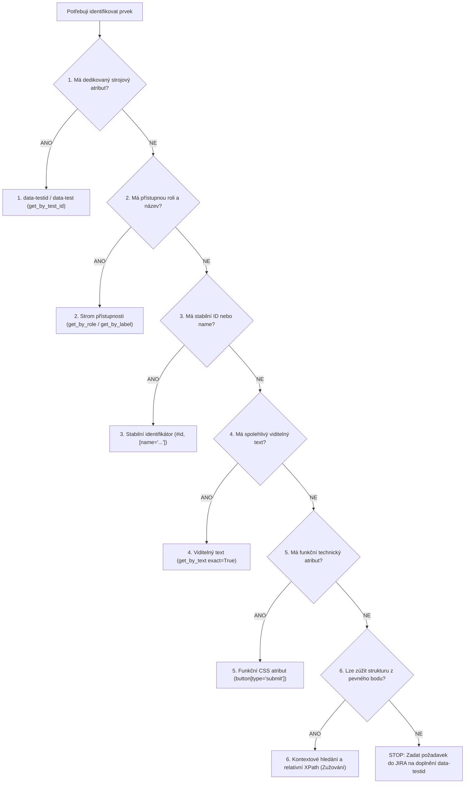

# 🪜 Jak by měl AI agent hledat prvky (Sestupná priorita 1–6)

Tento dokument definuje autoritativní rozhodovací strom a hierarchii priorit pro volbu lokátorů v Page Objects podle metodiky kurzu *Jak řídit AI automatizaci testů*.

> **Základní pravidlo:**  
> *Nejdřív hledá značky pro stroje, pak zkoumá účel a název. Teprve když vše selže, orientuje se podle struktury kódu.*

---

## 🧭 Rozhodovací hierarchie lokátorů (Sestupná priorita 1–6)



---

### 1. 🥇 Dedikované strojové atributy (`data-testid`, `data-test`)
* **Co to je:** Skryté štítky určené výhradně pro stroje a automatizované testování.
* **Proč:** Jsou naprosto imunní vůči změnám designu, překladům textů i rozložení stránky. Jde o nejstabilnější záchytný bod.
* **Playwright implementace (MANDATORNÍ):**
  ```python
  # Samostatný prvek
  self.email_input = page.get_by_test_id("email_input")
  
  # Kontextové řetězení kontejnerů (namísto indexů)
  self.logout_button = page.get_by_test_id("navigation").get_by_test_id("logout_button")
  ```

---

### 2. 🥈 Strom přístupnosti (Role + Přístupný název)
* **Co to je:** Hledání prvků tak, jak je vidí nevidomý uživatel se čtečkou obrazovky. Hledá se kombinace „Role“ (tlačítko, odkaz, textové pole) a „Názvu“ (např. „Odeslat“, „E-mail“).
* **Proč:** AI agenti nativně chápou strom přístupnosti. Pokud má prvek správnou sémantiku, agent přesně ví, k čemu slouží a jak s ním interagovat.
* **Playwright implementace:**
  ```python
  # Tlačítko podle sémantické role a přístupného jména
  self.submit_button = page.get_by_role("button", name="Uložit změny")
  
  # Formulářové pole provázané s <label>
  self.phone_input = page.get_by_label("Telefonní číslo")
  
  # Pole s unikátním placeholderem
  self.search_input = page.get_by_placeholder("Hledat kurz...")
  ```

---

### 3. 🥉 Stabilní identifikátory (`id`, `name`)
* **Co to je:** Nativní HTML identifikátory prvků v kódu stránky.
* **Na co dát pozor:** Agent se musí vyhnout dynamicky generovaným ID (např. `input_854`, `field_w123`), která se mění s každým načtením stránky nebo po buildu. Používat pouze garantovaně stabilní statické identifikátory!
* **Playwright implementace:**
  ```python
  # Stabilní HTML id (pokud není dynamické)
  self.email_field = page.locator("#email")
  
  # Stabilní atribut name ve formuláři
  self.ico_input = page.locator('input[name="ico"]')
  ```

---

### 4. 🔤 Viditelný text
* **Co to je:** Vyhledání prvku čistě podle statického textu, který je na něm napsaný (např. „Přihlásit se“).
* **Na co dát pozor:** Selže, pokud se web přepne do jiného jazyka (i18n), nebo pokud text změní copywriter. Vždy používejte přesnou shodu (`exact=True`) a pokud možno zúžení na rodičovský blok.
* **Playwright implementace:**
  ```python
  # Text s přesnou shodou uvnitř specifického bloku
  self.status_badge = page.get_by_test_id("order_summary").get_by_text("Zaplaceno", exact=True)
  ```

---

### 5. ⚙️ CSS selektory (podle funkčních atributů)
* **Co to je:** Hledání podle specifických vlastností přímo v HTML struktuře podle technického účelu prvku (např. vyhledání tlačítka podle technického typu `type="submit"`).
* **Na co dát pozor:** Agent se smí orientovat **pouze podle funkčních vlastností**. Zásadně nesmí používat CSS k hledání podle vzhledu nebo rozložení (např. třídy upravující barvy, okraje, velikost písma nebo mřížku).
* **Playwright implementace:**
  ```python
  # Hledání podle funkčního atributu type
  self.submit_btn = page.locator('button[type="submit"]')
  
  # Hledání podle funkčního typu vstupního pole
  self.password_field = page.locator('input[type="password"]')
  ```

---

### 6. 🔍 Kontextové hledání a relativní XPath (Zužování struktury)
* **Co to je:** Pokud prvek nelze najít přímo a agent musí složitě prohledávat „rodokmen“ stránky, musí postupovat krok za krokem: nejprve najde jednoznačný nadřazený blok (např. „Řádek obsahující produkt Hrnek“) a až v něm hledá konkrétní akci (např. „tlačítko Smazat“).
* **Na co dát pozor:** Agent musí používat **výhradně relativní orientaci** (odvíjí se od pevného záchytného bodu, např. od nalezeného textu). Nesmí sklouznout k prohledávání od úplného začátku stránky.
* **Playwright implementace:**
  ```python
  # 1. Krok: Najdi jednoznačný řádek s konkrétním kurzem
  course_row = page.locator("tr").filter(has_text="Python pro začátečníky")
  
  # 2. Krok: V rámci tohoto řádku najdi tlačítko pro registraci
  self.enroll_btn = course_row.get_by_role("button", name="Registrovat")
  ```

---

## 🚫 Čemu se musí AI agent absolutně vyhnout ❌

* ❌ **Absolutní cesty a pozice:** Navádění typu *„třetí prvek v pátém kontejneru“*, indexy `.first`, `.last`, `.nth(i)` nebo absolutní XPath cesty (např. `/html/body/div[2]/div/form/div[3]/button`). Webové stránky jsou dynamické a při jakékoliv změně rozložení se test okamžitě rozbije.
* ❌ **Generované CSS třídy a třídy vzhledu:** Třídy, které definují vizuální vzhled (např. `.btn-primary`, `.text-red-500`, `.col-md-6`) nebo jsou náhodně generované systémem při sestavování webu (např. `.css-1x84a9`, `._2bXp9`). Mění se při každé aktualizaci kódu nebo redesignu.

---

## 📝 Postup při chybějícím data-testid v aplikaci

Pokud prvek nelze spolehlivě identifikovat prioritou 1–3:
1. Použijte nejvyšší možný bezpečný fallback (priorita 2 až 5) a v kódu označte komentářem:
   ```python
   # TODO: Nahradit za get_by_test_id("submit_order") po doplnění vývojáři (viz JIRA DLCP-XXX)
   self.submit_btn = page.locator('button[type="submit"]')
   ```
2. Zadejte požadavek vývojářům do JIRA podle šablony níže.

### 📋 Šablona požadavku do JIRA pro doplnění data-testid

```markdown
* **Project:** Demo Login & Courses Portal (`DLCP`)
* **Issue Type:** 💡 Improvement / Task (případně Bug při blokaci testovatelnosti)
* **Summary:** `[Testability] Chybějící atribut data-testid pro <název_komponenty_nebo_prvku>`
* **Komponenta:** Frontend / UI
* **Priorita:** Medium

#### Popis požadavku:
V rámci automatizovaného testování v Playwrightu nelze prvek zacílit pomocí dedikovaného strojového atributu:
* **Stránka / URL:** `/courses`
* **Cílový prvek:** `<button>` pro filtrování kategorií
* **Aktuální stav v DOM:** `<button class="btn dropdown-toggle">Kategorie</button>`

#### Požadované řešení:
Přidat do šablony komponenty atribut `data-testid`:
```html
<button data-testid="course_category_filter" class="btn dropdown-toggle">Kategorie</button>
```
```
