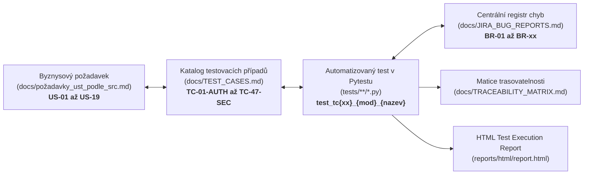

# 🧭 Standardy trasovatelnosti testů (Traceability Standards)

Tento dokument definuje závazná pravidla pro provázání požadavků, testovacích případů a kódu automatizovaných testů v projektu.

---

## 🎯 1. Princip úplné obousměrné trasovatelnosti

V testovací automatizaci musí být každý automatizovaný test dohledatelný od byznysového požadavku až po konkrétní řádek v kódu a naopak:



---

## 🏷️ 2. Nomenklatura a pravidla značení

### A. Formát kódu testovacího případu (ID)
* **Kanonický formát:** `TC-{číslo}-{MODUL}`
  * `{číslo}`: Dvoumístné číslo s úvodní nulou (`01` až `47`).
  * `{MODUL}`: Třípísmenný nebo čtyřpísmenný kód domény:
    * `AUTH` – Autentizace a správa sezení (US-01 až US-07, `TC-01-AUTH` až `TC-21-AUTH`)
    * `CRS` – Katalog kurzů (US-08 až US-10, `TC-22-CRS` až `TC-26-CRS`)
    * `ENR` – Zápis na kurz a Moje kurzy (US-11 až US-12, `TC-27-ENR` až `TC-31-ENR`)
    * `LEC` – Lektorské operace a vypsání běhů (US-13 až US-15, `TC-32-LEC` až `TC-38-LEC`)
    * `PRF` – Profil a domovská nástěnka (US-16 až US-17, `TC-39-PRF` až `TC-42-PRF`)
    * `SEC` – Bezpečnost, autorizace a sezení (US-18 až US-19, `TC-43-SEC` až `TC-47-SEC`)

### B. Standard pro docstring testu
Dle pravidla 8 v [AGENTS.md](../../../AGENTS.md) **musí** každý test v prvním řádku docstringu obsahovat ID a stručný popis:
```python
def test_tc01_auth_successful_registration(self, page: Page):
    """TC-01-AUTH: Úspěšná registrace nového zákaznického účtu."""
```

### C. Standard pro název testovací funkce
* Formát: `test_tc{číslo}_{modul}_{anglicky_vyjadreny_ucel}`
* Příklady:
  * `test_tc22_crs_catalog_display_for_guest`
  * `test_tc27_enr_successful_enrollment_with_ico_and_phone`
  * `test_tc43_sec_unauthenticated_private_url_access_blocked`

---

## 🏷️ 3. Pravidla pro Pytest Markery

Každá testovací metoda musí mít **přesně dva povinné typy markerů**:

1. **Doménový marker:**
   * `@pytest.mark.auth`
   * `@pytest.mark.courses`
   * `@pytest.mark.enrollment`
   * `@pytest.mark.lecturer`
   * `@pytest.mark.profile`
   * `@pytest.mark.security`

2. **Marker závažnosti (odvozený z priority v `TEST_CASES.md`):**
   * `@pytest.mark.smoke` – Pro kritické scénáře typu Happy Path a P1 (rychlé ověření po nasazení).
   * `@pytest.mark.regression` – Pro negativní scénáře, validace, edge cases a P2/P3.

3. **Speciální doplňkové markery:**
   * `@pytest.mark.parametrize(...)` – Pro data-driven testování variant.
   * `@pytest.mark.xfail(reason="BR-xx: ...")` – Pro známé reportované aplikační defekty.

---

## 🏗️ 4. Šablona struktury testu (AAA Pattern)

Každý vygenerovaný nebo psaný test musí striktně dodržovat 3 fáze:

```python
    @pytest.mark.auth
    @pytest.mark.smoke
    def test_tc01_auth_successful_registration(self, page: Page):
        """TC-01-AUTH: Úspěšná registrace zákaznického účtu."""
        # =====================================================================
        # 1. ARRANGE (Příprava stavu a Page Objectů)
        # =====================================================================
        register_page = RegisterPage(page)
        home_page = HomePage(page)
        new_user = generate_random_user()  # Z utils.data_generator (idempotence)

        register_page.open()

        # =====================================================================
        # 2. ACT (Kroky scénáře)
        # =====================================================================
        register_page.register(
            name=new_user["name"],
            email=new_user["email"],
            password=new_user["password"],
            password_again=new_user["password"]
        )

        # =====================================================================
        # 3. ASSERT (3úrovňová validace)
        # =====================================================================
        # Úroveň 1: Routing
        expect(page).to_have_url(home_page.URL)
        # Úroveň 2: Session state
        expect(home_page.navbar.logout_button).to_be_visible()
        # Úroveň 3: Data state / UI feedback
        expect(home_page.welcome_section).to_contain_text(new_user["name"])
```

---

## 📊 5. Přehled mapování modulů na cílové soubory

| Modul | Kód TC | User Stories | Cílový testovací soubor | Primární Page Object |
| :--- | :--- | :--- | :--- | :--- |
| **Autentizace** | `TC-01` až `TC-05` | US-01 (Registrace) | `tests/auth/test_register.py` | `RegisterPage` |
| | `TC-06` až `TC-10` | US-02 (Přihlášení) | `tests/auth/test_login.py` | `LoginPage` |
| | `TC-11` | US-03 (Odhlášení) | `tests/auth/test_logout.py` | `CoursesPage` / `LoginPage` |
| | `TC-12` až `TC-16` | US-04, US-05 (Reset hesla) | `tests/auth/test_password_reset.py` | `ForgotPasswordPage` |
| | `TC-17` až `TC-19` | US-06 (Ověření e-mailu) | `tests/auth/test_password_reset.py` | `LoginPage` |
| | `TC-20` až `TC-21` | US-07 (Rate Limiting) | `tests/auth/test_login.py` | `LoginPage` |
| **Katalog kurzů** | `TC-22` až `TC-26` | US-08 až US-10 | `tests/courses/test_courses.py` | `CoursesPage`, `CourseDetailPage` |
| **Zápis na kurz** | `TC-27` až `TC-31` | US-11 až US-12 | `tests/enrollment/test_enrollment.py` | `EnrollmentPage`, `MyCoursesPage` |
| **Správa lektorem** | `TC-32` až `TC-38` | US-13 až US-15 | `tests/lecturer/test_lecturer.py` | `CreateCoursePage`, `CoursesPage` |
| **Profil a nástěnka**| `TC-39` až `TC-42` | US-16 až US-17 | `tests/profile/test_profile.py` | `ProfilePage`, `HomePage` |
| **Bezpečnost** | `TC-43` až `TC-47` | US-18 až US-19 | `tests/security/test_security.py` | `ProfilePage`, `LoginPage` |
