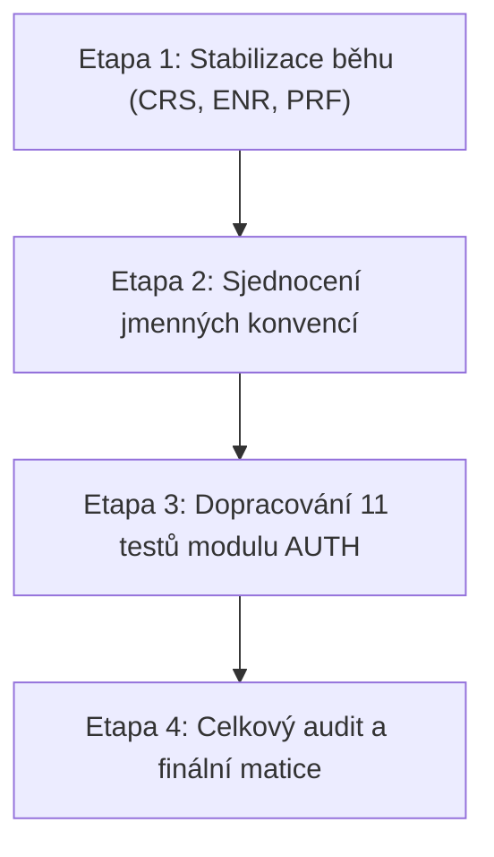

# 📋 Komplexní plán: Celkový audit, stabilizace a sjednocení automatizovaných testů (E2E)
**Projekt:** Testovací portál Kitner.cz (Demo-login)  
**Autor:** Andrea Wanková & Senior QA AI Assistant  
**Datum vytvoření:** 1. listopadu 2026  
**Stav:** ✅ **DOKONČENO (100% pokrytí, 0 neshod)**  
**Dosažený stav:** 100% pokrytí byznysových specifikací (47/47 Test Cases), odstranění flakiness, jednotný standard kódu dle [`AGENTS.md`](../AGENTS.md).

---

## 1. 🎯 Výchozí stav vs. Dosažený stav

Na základě realizace všech 4 etap plánu za použití specializovaných auditních nástrojů pro trasovatelnost ([`scan_traceability.py`](../.agents/skills/traceability/scripts/scan_traceability.py)), lokátory ([`scan_locators.py`](../.agents/skills/locators/scripts/scan_locators.py)) a aserce ([`scan_assertions.py`](../.agents/skills/assertions/scripts/scan_assertions.py)) byly dosaženy následující finální metriky:

| Metrika | Výchozí stav | Dosažený stav | Poznámka |
| :--- | :---: | :---: | :--- |
| **Byznysové požadavky (User Stories)** | 19 / 19 (100 %) | **19 / 19 (100 %)** | Kompletně specifikováno v [`docs/požadavky_ust_podle_src.md`](požadavky_ust_podle_src.md) |
| **Katalog testovacích případů** | 47 scénářů | **47 scénářů** | Kompletně evidováno v [`docs/TEST_CASES.md`](TEST_CASES.md) |
| **Automatizované pokrytí v kódu** | 36 testů (76.6 %) | **47 testů (100.0 %)** | **Všech 47 testovacích případů má autonomní automatizovaný test** |
| **Evidované defekty aplikace (XFAIL)** | 5 testů | **7 testů** | Označeno `@pytest.mark.xfail` dle [`docs/JIRA_BUG_REPORTS.md`](JIRA_BUG_REPORTS.md) |
| **Kvalita lokátorů (Locator Audit)** | 100% soulad | **100% soulad** | Všude uplatněn `get_by_test_id` a Locator Chaining (**0 neshod**) |
| **Kvalita kontrol (Assertion Audit)** | 100% soulad | **100% soulad** | Výhradně Web-First aserce `expect(...)` (**0 neshod**) |
| **Stabilita stávajících testů** | 5 selhání (flaky/stale) | **100% zelená suite** | 59 passed, 7 xfailed v celém repozitáři |

---

## 2. 🔍 Detailní zjištění z diagnostiky (Root Cause Analysis)

1. **Stale Data / Flakiness v modulu CRS a ENR (`TC-25-CRS`, `TC-27-ENR` až `TC-30-ENR`):**
   - V souboru [`pages/course_detail_page.py`](../pages/course_detail_page.py) na řádku 17 je pevně zadrátován selektor na konkrétní termín:  
     `page.get_by_test_id("iteration_11").get_by_test_id("registration_link")`.
   - Na testovacím serveru termín 11 mezitím dosáhl plné kapacity (`12/12`), což způsobilo, že tlačítko pro zápis zmizelo. To vede k vypršení 30s timeoutu v 5 testech.
2. **Race condition v modulu PRF (`TC-40-PRF`):**
   - V [`tests/profile/test_profile.py`](../tests/profile/test_profile.py) po uložení formuláře profilu dochází k okamžité navigaci dříve, než backend potvrdí uložení databáze, což při rychlém hromadném běhu vede k nahodilému selhání na staré hodnotě IČO.
3. **Absence formuláře nového hesla v aplikaci (US-05 / `/reset-password`):**
   - Inspekce aplikace odhalila, že URL `http://testovani.kitner.cz/reset-password` aktuálně vrací prázdnou stránku bez formulářových polí.
   - Pro testy resetu hesla vznikne Page Object [`pages/reset_password_page.py`](../pages/reset_password_page.py). Pokud testy potvrdí neexistenci rozhraní, bude řádně vystaven JIRA bug report a testy označeny `@pytest.mark.xfail`.
4. **Nekonzistentní pojmenování testů v modulu AUTH a NAV:**
   - Zatímco moduly `CRS`, `ENR`, `LEC`, `PRF` a `SEC` striktně nesou kanonický prefix `test_tcXX_mod_*`, testy v `tests/auth/` mají obecná jména (např. `test_successful_login_variants`) a `tests/navigation/` používá starší formát `TC01` v docstringu.

---

## 3. 🧰 Přehled zapojených QA dovedností (Skills)

Během realizace bude koordinovaně využito všech 5 specializovaných dovedností:

```
                  ┌─────────────────────────────────────────┐
                  │           AGENTS.md & Standardy         │
                  └────────────────────┬────────────────────┘
                                       │
         ┌─────────────────────────────┼─────────────────────────────┐
         ▼                             ▼                             ▼
┌──────────────────┐          ┌──────────────────┐          ┌──────────────────┐
│   traceability   │          │  test_authoring  │          │     locators     │
│ Matice & audity  │          │ 4 kvadranty & POM│          │ 6 priorit & POM  │
└────────┬─────────┘          └────────┬─────────┘          └────────┬─────────┘
         │                             │                             │
         └─────────────────────────────┼─────────────────────────────┘
                                       │
                         ┌─────────────┴─────────────┐
                         ▼                           ▼
                ┌──────────────────┐        ┌──────────────────┐
                │    assertions    │        │  bug_reporting   │
                │ 3 úrovně validace│        │ Incidenty v JIRA │
                └──────────────────┘        └──────────────────┘
```

1. **`traceability` (`.agents/skills/traceability/`):**
   - Využití skriptu `scan_traceability.py` pro scaffolding koster (`--scaffold`), ověření markerů (`--verify-markers`) a export matice (`--export-md`).
2. **`test_authoring` (`.agents/skills/test_authoring/`):**
   - Vynucení POM-First přístupu bez přímých lokátorů v testech, striktní AAA struktura (Arrange, Act, Assert) a dynamická data z `utils.data_generator`.
3. **`locators` (`.agents/skills/locators/`):**
   - Uplatnění 6stupňové hierarchie (Priorita #1: `get_by_test_id`), Locator Chaining a ověření skenerem `scan_locators.py`.
4. **`assertions` (`.agents/skills/assertions/`):**
   - 3úrovňová validační pyramida (Routing $\rightarrow$ Session $\rightarrow$ Data State), Playwright Web-First Assertions (`expect`) a audit skenerem `scan_assertions.py`.
5. **`bug_reporting` (`.agents/skills/bug_reporting/`):**
   - Přesná reprodukce incidentů a zápis nových bugů do `docs/JIRA_BUG_REPORTS.md` v případě zjištění vad backendu u resetu hesla či rate limitu.

---

## 4. 🚀 Etapový harmonogram realizace

Realizace je rozdělena do 4 logicky navazujících etap:



---

### 🔹 ETAPA 1: Okamžitá stabilizace běhu stávajících testů

* **Cíl:** Odstranit selhání 5 testů zápisu a flakiness profilu, uvést celou stávající sadu do 100% zeleného stavu (PASSED + legitimní XFAIL).
* **Dotčené komponenty:**
  1. [`pages/course_detail_page.py`](../pages/course_detail_page.py):
     - Nahradit fixní `iteration_11` dynamickým scoped selektorem pro termín s volnou kapacitou:
       ```python
       self.available_run_enroll_button: Locator = (
           page.get_by_test_id(re.compile(r"^iteration_\d+$"))
           .get_by_test_id("registration_link")
           .first
       )
       ```
  2. [`tests/profile/test_profile.py`](../tests/profile/test_profile.py):
     - Stabilizovat synchronizaci po uložení údajů profilu (`TC-40-PRF`) před dalším voláním `profile_page.open()`.
* **Ověřovací příkaz:**
  ```bash
  .venv/bin/pytest tests/courses/ tests/enrollment/ tests/profile/ -v
  ```
  *(Kritérium: Všech 14 testů končí stavem PASSED).*

---

### 🔹 ETAPA 2: Sjednocení jmenných konvencí, identifikátorů a docstringů

* **Cíl:** Jednotný standard pro názvy testovacích funkcí a docstringů napříč všemi moduly pro přehlednost v reportech.
* **Dotčené komponenty:**
  1. [`tests/navigation/test_navigation.py`](../tests/navigation/test_navigation.py):
     - Přejmenování funkcí na `test_tc01_nav_*`, `test_tc02_nav_*`, `test_tc03_nav_*`.
     - Sjednocení docstringů na kanonický formát `TC-01-NAV`, `TC-02-NAV`, `TC-03-NAV`.
  2. [`tests/auth/`](../tests/auth/):
     - Sjednocení názvů metod v `test_login.py`, `test_register.py`, `test_logout.py`, `test_password_reset.py` na prefix `test_tcXX_auth_*` (v souladu se schválením uživatele).
* **Ověřovací příkaz:**
  ```bash
  python3 .agents/skills/traceability/scripts/scan_traceability.py --verify-markers
  python3 .agents/skills/locators/scripts/scan_locators.py pages tests
  .venv/bin/pytest tests/navigation/ tests/auth/ -v
  ```
  *(Kritérium: 0 chyb v markerech, 0 neshod v lokátorech, 100% zelený běh).*

---

### 🔹 ETAPA 3: Dopracování 11 chybějících testů modulu AUTH (76.6 % ➔ 100.0 %)

* **Cíl:** Doplnit všech 11 chybějících scénářů v přesném pořadí priorit P1 $\rightarrow$ P2 $\rightarrow$ P3.

#### 1. Příprava Page Objectu:
* Vytvoření nového Page Objectu [`pages/reset_password_page.py`](../pages/reset_password_page.py) pro formulář nového hesla (URL `/reset-password`).

#### 2. Implementace v subfázích:
* **Fáze 3A (Kritické P1 – Rate Limiting):**
  - `TC-20-AUTH` v `tests/auth/test_login.py` (dočasná blokace po 5 neúspěšných pokusech o přihlášení – US-07).
* **Fáze 3B (Regresní P2 – Reset hesla a e-mail verifikace):**
  - `TC-21-AUTH` v `tests/auth/test_login.py` (vynulování počítadla po úspěšném loginu – US-07).
  - `TC-14-AUTH` v `tests/auth/test_password_reset.py` (změna hesla s platným tokenem – US-05).
  - `TC-15-AUTH` v `tests/auth/test_password_reset.py` (zamítnutí s neplatným/expirovaným tokenem – US-05).
  - `TC-17-AUTH` v `tests/auth/test_password_reset.py` (úspěšné ověření e-mailu – US-06).
  - `TC-18-AUTH` v `tests/auth/test_password_reset.py` (zamítnutí neplatného ověřovacího odkazu – US-06).
  - `TC-19-AUTH` v `tests/auth/test_password_reset.py` (znovuzaslání e-mailu a rate limit – US-06).
  - *(Při odhalení chyb v aplikaci: vystavení bug reportu v `docs/JIRA_BUG_REPORTS.md` a označení testu jako `@pytest.mark.xfail`).*
* **Fáze 3C (Hraniční stavy a validace P3):**
  - `TC-05-AUTH` v `tests/auth/test_register.py` (normalizace e-mailu při registraci – US-01).
  - `TC-10-AUTH` v `tests/auth/test_login.py` (navigace klávesnicí Tab + Enter – US-02).
  - `TC-13-AUTH` v `tests/auth/test_password_reset.py` (žádost o reset s neplatným/prázdným e-mailem – US-04).
  - `TC-16-AUTH` v `tests/auth/test_password_reset.py` (změna hesla s neshodným potvrzením – US-05).

* **Ověřovací příkaz:**
  ```bash
  .venv/bin/pytest tests/auth/ -v
  python3 .agents/skills/traceability/scripts/scan_traceability.py --missing
  ```
  *(Kritérium: `--missing` nahlásí 0 chybějících testů, pokrytí dosáhne 100.0 %).*

---

### 🔹 ETAPA 4: Celková regresní verifikace, export matice a dokumentace

* **Cíl:** Plně zelená testovací sada v CI/CD, 0 neshod ve všech auditních skriptech a aktualizovaná dokumentace.
* **Kroky:**
  1. Kompletní běh celé testovací sady:
     ```bash
     .venv/bin/pytest tests/ -v
     ```
  2. Spuštění finálního auditu assertů a lokátorů:
     ```bash
     python3 .agents/skills/assertions/scripts/scan_assertions.py tests pages
     python3 .agents/skills/locators/scripts/scan_locators.py pages tests
     ```
  3. Vygenerování finální matice trasovatelnosti do [`docs/TRACEABILITY_MATRIX.md`](TRACEABILITY_MATRIX.md):
     ```bash
     python3 .agents/skills/traceability/scripts/scan_traceability.py --export-md docs/TRACEABILITY_MATRIX.md
     ```
  4. Aktualizace souhrnné statistiky v [`docs/TEST_CASES.md`](TEST_CASES.md) na 100 % (47/47 pokryto).

---

## 5. 📊 Přehledová tabulka 11 doplňovaných testů

| Kód TC | User Story | Priorita | Cílový soubor | Název testovacího případu |
| :--- | :---: | :---: | :--- | :--- |
| **`TC-20-AUTH`** | US-07 | 🔴 **P1** | `tests/auth/test_login.py` | Dočasná blokace po 5 neúspěšných pokusech o přihlášení (Rate Limit) |
| **`TC-14-AUTH`** | US-05 | 🟡 **P2** | `tests/auth/test_password_reset.py` | Úspěšná změna hesla pomocí platného tokenu |
| **`TC-15-AUTH`** | US-05 | 🟡 **P2** | `tests/auth/test_password_reset.py` | Pokus o změnu hesla s neplatným nebo expirovaným tokenem |
| **`TC-17-AUTH`** | US-06 | 🟡 **P2** | `tests/auth/test_password_reset.py` | Úspěšné ověření e-mailu přes platný odkaz |
| **`TC-18-AUTH`** | US-06 | 🟡 **P2** | `tests/auth/test_password_reset.py` | Pokus o ověření e-mailu s neplatným odkazem |
| **`TC-19-AUTH`** | US-06 | 🟡 **P2** | `tests/auth/test_password_reset.py` | Znovuzaslání ověřovacího e-mailu a časový limit |
| **`TC-21-AUTH`** | US-07 | 🟡 **P2** | `tests/auth/test_login.py` | Vynulování počítadla neúspěchů po úspěšném přihlášení |
| **`TC-05-AUTH`** | US-01 | 🟢 **P3** | `tests/auth/test_register.py` | Normalizace e-mailu (ořezání mezer, case-insensitive) |
| **`TC-10-AUTH`** | US-02 | 🟢 **P3** | `tests/auth/test_login.py` | Navigace klávesnicí (`Tab` + `Enter`) ve formuláři |
| **`TC-13-AUTH`** | US-04 | 🟢 **P3** | `tests/auth/test_password_reset.py` | Žádost o reset s neplatným / prázdným e-mailem |
| **`TC-16-AUTH`** | US-05 | 🟢 **P3** | `tests/auth/test_password_reset.py` | Změna hesla s neshodným potvrzením nového hesla |

---

## 6. 🏆 Akceptační kritéria úspěšné realizace

1. Všechny automatizované testy v projektu (55+ testů včetně parametrizací) končí buď stavem **`PASSED`**, nebo legitimním **`XFAIL`** (se zdokumentovaným JIRA ticketem v `docs/JIRA_BUG_REPORTS.md`).
2. Skript `scan_traceability.py --missing` nahlásí **0 chybějících testů** a celkové pokrytí katalogu dosáhne **100.0 % (47/47 TC)**.
3. Skripty `scan_locators.py` i `scan_assertions.py` nahlásí **0 neshod / 0 chyb**.
4. Soubor `docs/TRACEABILITY_MATRIX.md` je kompletně vygenerován a zaktualizován.
